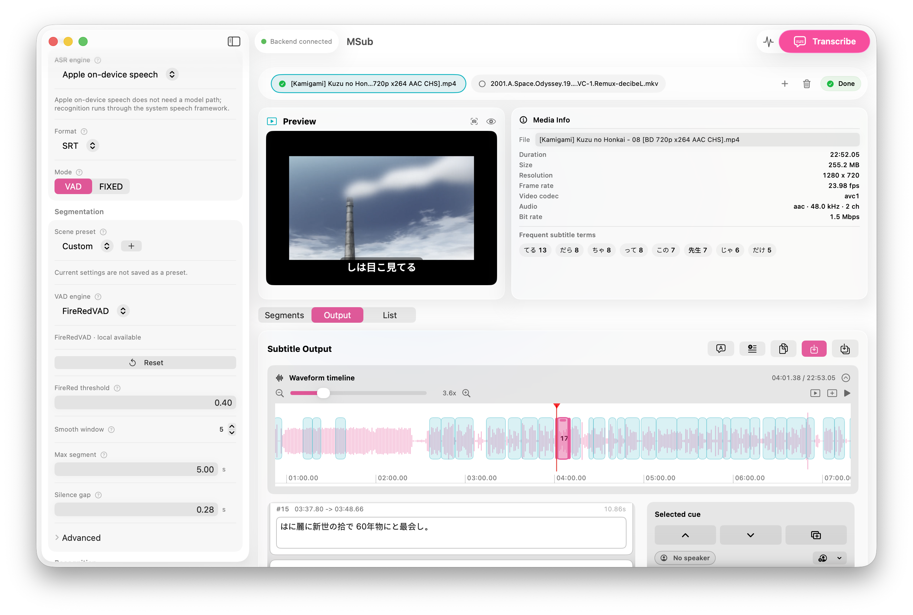

# MSub

[简体中文](README.zh-CN.md) | [繁體中文](README.zh-Hant.md) | [Releases](https://github.com/kGMia/MSub/releases)

MSub is a native macOS subtitle app for Apple Silicon Macs. It turns local video or audio into editable subtitles with MLX speech-recognition models.



## Main Features

- Generate SRT, VTT, ASS, TXT, or JSON subtitles from local media.
- Preview speech segments before transcription.
- Edit subtitle blocks in a native macOS interface.
- Adjust timing on a waveform timeline.
- Process multiple files in order.
- Save subtitles beside the source media.
- Optional speaker labels, emotion tags, and translation tools.
- CLI and `msub://` control support for automation and AI agents.
- Optional native Qwen3 MLX / FireRedVAD Core ML, with per-stage processing details.
- Bilingual styling, playhead splitting, batch edits, quality review and draft recovery in the File menu.

See the [milestone notes](MILESTONE_2026-10-10.md) for scope and validation limits, and the [model audit](MODEL_UPDATE_2026-10-10.md) for current versions (Chinese).

## Requirements

- Apple Silicon Mac.
- macOS 27 or newer for the current native app target.
- Python 3.10-3.13 for backend engines such as FireRedASR2 and native fallback; configured native workflows can run without starting Python.
- `uv` for Python dependency management.
- `ffmpeg` for audio extraction.
- Several GB of free disk space for speech models.

## Install

Download packaged builds from [GitHub Releases](https://github.com/kGMia/MSub/releases), or build MSub locally.

Current builds are ad-hoc signed and not notarized. If macOS says the app cannot be verified, Control-click `MSub.app`, choose **Open**, then confirm.

## Build From Source

This repository is the macOS app project. During development and release packaging, the Python backend is loaded from the full workspace that contains `src/huz_subtitle`, `pyproject.toml`, `uv.lock`, and `apps/MSub`.

The current source uses macOS 27 SDK APIs and requires Xcode 27 and macOS 27. Prefer the Xcode project for native MLX inference because `swift run` alone does not compile the required Metal resources. Trust the pinned Swift package plugins/macros on first build and retain the scheme's Metal compatibility pre-action. For SwiftPM builds, resolve dependencies and run `python3 Scripts/patch-mlx-metal.py .build/checkouts` before building.

Run the native app target from this repository:

```bash
git clone https://github.com/kGMia/MSub.git
cd MSub
env CLANG_MODULE_CACHE_PATH=.swift-module-cache swift run
```

For transcription in a source build, launch with a backend workspace:

```bash
MSUB_WORKSPACE=/path/to/full/workspace \
env CLANG_MODULE_CACHE_PATH=.swift-module-cache swift run
```

Build a local app bundle from the full workspace:

```bash
cd /path/to/full/workspace
MSUB_SIGNING_MODE=adhoc MSUB_INCLUDE_MODEL=0 apps/MSub/Scripts/build-release.sh
```

The app is created under `.xcode-derived-release/Build/Products/Release/MSub.app`.

## Command Line

Control the native app after building it:

```bash
.build/debug/MSub --open /path/video.mp4 --transcribe
open 'msub://open?path=/path/video.mp4&preview=1'
open 'msub://stop'
```

The backend workspace also provides direct subtitle generation:

```bash
UV_CACHE_DIR=.uv-cache uv run msub-srt input.mp4 --format srt
```

Legacy commands `huz-srt` and `huz-web` still work, but new usage should prefer `msub-srt` and `msub-web`.

## Models

MSub can use:

- FireRedASR2-AED MLX, the default ASR model.
- SenseVoiceSmall MLX, useful for multilingual speech and rich info.
- MiMo-V2.5-ASR MLX 4-bit, useful for Chinese/English speech.
- FireRedVAD, used for speech activity detection.
- pyannote.audio, optional speaker diarization.
- ERes2NetV2 and emotion2vec, optional speaker/emotion features.

Models may be downloaded from Hugging Face or placed in a local `models/` folder.

## Open Source Projects Used

MSub is built on top of:

- [MLX](https://github.com/ml-explore/mlx)
- [mlx-audio](https://github.com/Blaizzy/mlx-audio)
- [FireRedASR](https://github.com/FireRedTeam/FireRedASR)
- [FireRedVAD](https://github.com/FireRedTeam/FireRedVAD)
- [SenseVoice](https://github.com/FunAudioLLM/SenseVoice)
- [MiMo-Audio](https://github.com/XiaomiMiMo/MiMo-Audio)
- [pyannote.audio](https://github.com/pyannote/pyannote-audio)
- [FFmpeg](https://ffmpeg.org/)
- [FastAPI](https://fastapi.tiangolo.com/) and [Uvicorn](https://www.uvicorn.org/)
- [uv](https://github.com/astral-sh/uv)

Please check each model and dependency license before redistribution or commercial use.

## Notes

- Transcription runs locally after the backend and models are available.
- First use may need network access to download models.
- Large ASR models can take time to download.
- Subtitle timing is based on VAD speech segments, not word-level timestamps.
- Optional speaker and emotion features require extra dependencies and models.
- The app starts a local backend service and listens only on a local port.

## Project Layout

- `Sources/MSub`: native macOS app source.
- `Scripts`: release, packaging, and validation scripts.
- `MSub.xcodeproj`: Xcode project.
- `Package.swift`: Swift Package manifest for local builds.
- `RELEASE.md`: release build notes.
