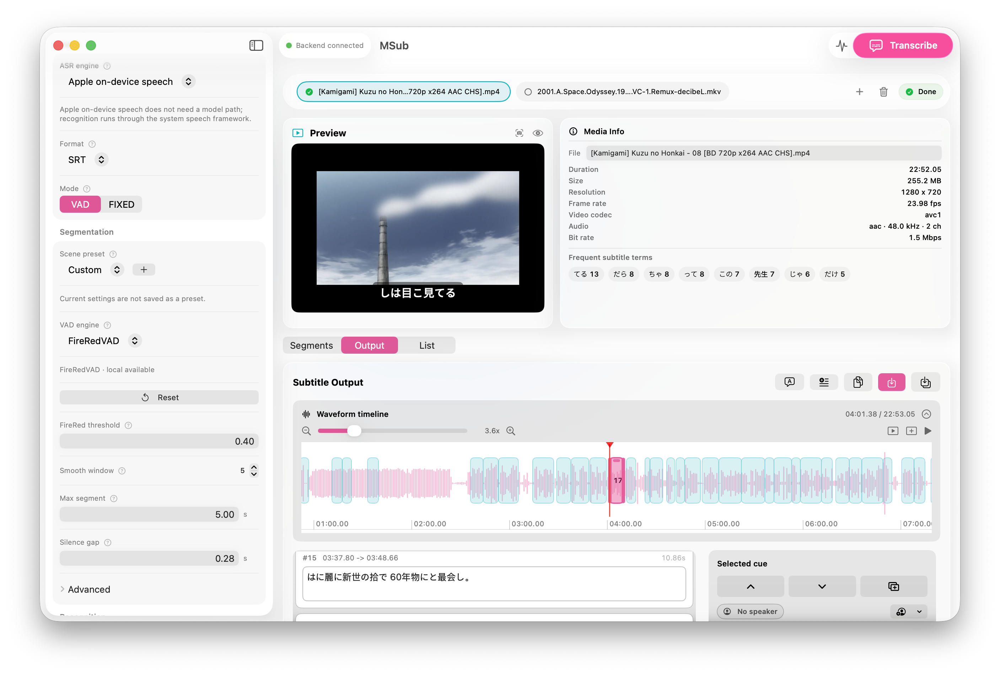

# MSub

[简体中文](README.zh-CN.md) | [繁體中文](README.zh-Hant.md) | [Releases](https://github.com/kGMia/MSub/releases)

MSub is a native macOS subtitle app for Apple Silicon Macs. It turns local video or audio into editable subtitles with MLX speech-recognition models.



## Main Features

- Generate SRT, VTT, ASS, TXT, or JSON subtitles from local media.
- Preview speech segments before transcription.
- Edit subtitle blocks in a native macOS interface.
- Adjust timing on a waveform timeline.
- Process multiple files in order.
- Save subtitles beside the source media.
- Optional speaker labels, emotion tags, and translation tools.
- CLI and `msub://` control support for automation and AI agents.
- Optional native Qwen3 MLX / FireRedVAD Core ML, with per-stage processing details.
- Bilingual styling, playhead splitting, batch edits, quality review and draft recovery in the File menu.

See the [milestone notes](MILESTONE_2026-10-10.md) for scope and validation limits, and the [model audit](MODEL_UPDATE_2026-10-10.md) for current versions (Chinese).

Japanese-specialized Qwen selection and vocalization review: [usage and validation notes](JAPANESE_MODEL_2026-10-29.md) (Chinese).

## Requirements

- Apple Silicon Mac.
- macOS 27 or newer for the current native app target.
- Building from source requires a Swift 6.4 toolchain; MSub uses Swift 6 language mode.
- Python 3.10-3.13 for backend engines such as FireRedASR2 and native fallback; configured native workflows can run without starting Python.
- `uv` for Python dependency management.
- `ffmpeg` for audio extraction.
- Several GB of free disk space for speech models.

## Install

Download packaged builds from [GitHub Releases](https://github.com/kGMia/MSub/releases), or build MSub locally.

Current builds are ad-hoc signed and not notarized. If macOS says the app cannot be verified, Control-click `MSub.app`, choose **Open**, then confirm.

## Build From Source

This repository is the macOS app project. During development and release packaging, the Python backend is loaded from the full workspace that contains `src/huz_subtitle`, `pyproject.toml`, `uv.lock`, and `apps/MSub`.

The current source uses macOS 27 SDK APIs and requires Xcode 27 and macOS 27. Prefer the Xcode project for native MLX inference because `swift run` alone does not compile the required Metal resources. Trust the pinned Swift package plugins/macros on first build and retain the scheme's Metal compatibility pre-action. For SwiftPM builds, resolve dependencies and run `python3 Scripts/patch-mlx-metal.py .build/checkouts` before building.

Run the native app target from this repository:

```bash
git clone https://github.com/kGMia/MSub.git
cd MSub
env CLANG_MODULE_CACHE_PATH=.swift-module-cache swift run
```

For transcription in a source build, launch with a backend workspace:

```bash
MSUB_WORKSPACE=/path/to/full/workspace \
env CLANG_MODULE_CACHE_PATH=.swift-module-cache swift run
```

Build a local app bundle from the full workspace:

```bash
cd /path/to/full/workspace
MSUB_SIGNING_MODE=adhoc MSUB_INCLUDE_MODEL=0 apps/MSub/Scripts/build-release.sh
```

The app is created under `.xcode-derived-release/Build/Products/Release/MSub.app`.

## Command Line

Control the native app after building it:

```bash
.build/debug/MSub --open /path/video.mp4 --transcribe
open 'msub://open?path=/path/video.mp4&preview=1'
open 'msub://stop'
```

The backend workspace also provides direct subtitle generation:

```bash
UV_CACHE_DIR=.uv-cache uv run msub-srt input.mp4 --format srt
```

Legacy commands `huz-srt` and `huz-web` still work, but new usage should prefer `msub-srt` and `msub-web`.

## Models

MSub can use:

- FireRedASR2-AED MLX, the default ASR model.
- SenseVoiceSmall MLX, useful for multilingual speech and rich info.
- MiMo-V2.5-ASR MLX 4-bit, useful for Chinese/English speech.
- FireRedVAD, used for speech activity detection.
- pyannote.audio, optional speaker diarization.
- ERes2NetV2 and emotion2vec, optional speaker/emotion features.

Models may be downloaded from Hugging Face or placed in a local `models/` folder.

## Open Source Projects Used

MSub is built on top of:

- [MLX](https://github.com/ml-explore/mlx)
- [mlx-audio](https://github.com/Blaizzy/mlx-audio)
- [FireRedASR](https://github.com/FireRedTeam/FireRedASR)
- [FireRedVAD](https://github.com/FireRedTeam/FireRedVAD)
- [SenseVoice](https://github.com/FunAudioLLM/SenseVoice)
- [MiMo-Audio](https://github.com/XiaomiMiMo/MiMo-Audio)
- [pyannote.audio](https://github.com/pyannote/pyannote-audio)
- [FFmpeg](https://ffmpeg.org/)
- [FastAPI](https://fastapi.tiangolo.com/) and [Uvicorn](https://www.uvicorn.org/)
- [uv](https://github.com/astral-sh/uv)

Please check each model and dependency license before redistribution or commercial use.

## Notes

- Transcription runs locally after the backend and models are available.
- First use may need network access to download models.
- Large ASR models can take time to download.
- Subtitle timing is based on VAD speech segments, not word-level timestamps.
- Optional speaker and emotion features require extra dependencies and models.
- The app starts a local backend service and listens only on a local port.

## Project Layout

- `Sources/MSub`: native macOS app source.
- `Scripts`: release, packaging, and validation scripts.
- `MSub.xcodeproj`: Xcode project.
- `Package.swift`: Swift Package manifest for local builds.
- `RELEASE.md`: release build notes.


### FFmpeg for source builds

The large FFmpeg executable is no longer stored under `Sources/MSub`. Set
`MSUB_FFMPEG_SOURCE` to an executable, place it at `.cache/bin/ffmpeg` under this
app directory, or make `ffmpeg` available on the build process PATH. Xcode's
packaging phase copies it into the app resources. Use a standalone Apple Silicon
binary for distribution; a package-manager binary may depend on local libraries.
For `swift run`, `MSUB_FFMPEG` can point to a local executable.


### Native Qwen idle residency

After successful native recognition, one model stays resident for up to 45 seconds
on Macs with at least 16 GiB memory, reducing repeated model loads. Smaller Macs
release immediately by default. Set `MSUB_NATIVE_QWEN_IDLE_SECONDS=0` to disable,
or choose a finite duration up to 120 seconds. Failure, cancellation, Python
handoff, window closure and memory-pressure handling release the model (active
decoding must finish draining first). This trades short-lived memory use for
potentially faster repeated recognition; no throughput improvement is guaranteed.

### Frontend/backend release pairing

`Backend/` is the reviewed snapshot of the Python workspace: source, tests,
maintenance scripts, `pyproject.toml` and `uv.lock`. Its `manifest.json` records
SHA-256 for each input and a content-based backend revision. The Git commit
containing this snapshot identifies the matching frontend. Models, media,
virtual environments, credentials and generated outputs are not included.

After backend changes, from the app repository run:

```sh
python3 Scripts/backend-snapshot.py --sync --workspace /path/to/Huz
python3 Scripts/backend-snapshot.py --workspace /path/to/Huz
```

Review and commit the snapshot together with app changes. Release preflight and
Release packaging reject drift between the live workspace and snapshot; the
app bundle receives `backend/backend-source-manifest.json`. Debug remains free
to use live edits and does not claim release provenance. CI verifies the
manifest and runs lightweight Python contracts without downloading ML models.

To reconstruct a clean full workspace, place this repository at
`<workspace>/apps/MSub`, copy the contents of its `Backend/` directory into the
workspace root (excluding `manifest.json`), then install dependencies from
`uv.lock` using `uv sync --frozen`. Provision required models and ffmpeg
separately as described above. The snapshot is a release boundary, not a second
place for day-to-day backend edits.
